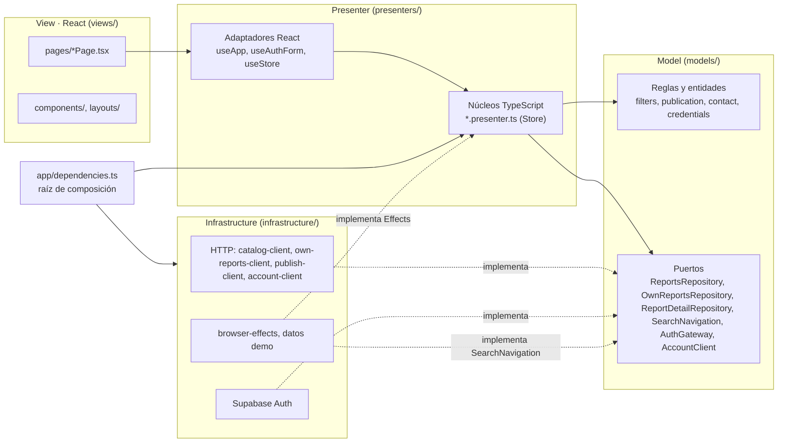

# Arquitectura MVP de la aplicación web

Este documento describe la arquitectura que realmente implementa `apps/web`. Las responsabilidades del monorepo (API, catálogo, base de datos) siguen en [la guía de arquitectura](../architecture.md); las reglas operativas para agentes están en la skill [`mvp-react`](../../.agents/skills/mvp-react/SKILL.md).

## 1. Qué es MVP

**Model–View–Presenter** separa una interfaz en tres responsabilidades:

- **Model**: el problema del dominio. Entidades, reglas, validaciones y cálculos, más los contratos para obtener datos. No sabe que existe una pantalla.
- **View**: lo que se ve. Muestra datos ya preparados y entrega los eventos del usuario. En nuestra variante es una _Passive View_ ([Fowler](https://martinfowler.com/eaaDev/PassiveScreen.html)): no decide nada importante.
- **Presenter**: intermediario. Recibe los eventos de la View, ejecuta operaciones del Model, administra el estado de presentación (carga, error, éxito, vacío) y transforma los resultados en datos listos para mostrar.

## 2. Por qué MVP en PerdiU

La primera versión concentraba en `App.tsx` 17 estados, reglas de negocio, navegación y efectos del navegador, y las páginas calculaban conteos o manejaban formularios. MVP permite:

- **probar** las reglas y los flujos sin navegador: el Model y el Presenter son TypeScript puro;
- **explicar** cada cambio por su capa: una regla nueva va al Model, un mensaje al Presenter y un estilo a la View;
- **cambiar** la tecnología de la interfaz o de los servicios sin reescribir las reglas.

La aplicación es una SPA de **React 19 + Vite**, no Next.js. Las guías de Next.js sobre Server/Client Components no aplican: no hay renderizado en servidor ni Server Actions, y el backend es la API NestJS de `apps/api`. React sigue siendo la tecnología de la View; Vite solo compila y sirve los archivos.

## 3. Diagrama de capas



Las flechas son dependencias de código: la View conoce al Presenter, el Presenter al Model y nadie conoce a la View. La infraestructura implementa contratos del Model (o la interfaz `Effects` del Presenter) y solo `app/dependencies.ts` la conecta.

## 4. Estructura implementada

```text
apps/web/src/
├── app/                      Entrada y composición
│   ├── main.tsx              Monta React
│   ├── App.tsx               Conecta presenters y AppShell
│   └── dependencies.ts       Crea adapters e inyecta dependencias
├── models/                   Model (sin React ni navegador)
│   ├── auth/credentials.ts   Reglas de correo y contraseña
│   ├── auth/session.ts       Puertos AuthGateway y AccountClient
│   └── reports/              report, filters, stats, publication, contact, own-reports y puertos
├── presenters/               Presenter
│   ├── store.ts              Estado observable compartido
│   ├── useStore.ts           Adaptador React genérico
│   ├── effects.ts            Efectos que el presenter pide (temporizador, dirección, WhatsApp, foto…)
│   ├── app/                  shell (navegación), notice (avisos), useApp
│   ├── auth/                 auth (sesión), auth-form (formulario), useAuthForm
│   ├── catalog/              catalog (consulta), filters (selección), search (URL y ciclo de vida)
│   └── reports/              reports (demo/guardados), own-reports, report-detail y report-route, publish, usePublishPage (limpieza de vistas previas), report-card
├── views/                    View
│   ├── layouts/              AppShell, Sidebar, AppHeader
│   ├── pages/                Una página por sección
│   ├── components/           Tarjetas, filtros, detalle y estados del catálogo
│   └── styles.css
└── infrastructure/           Adapters
    ├── http/                 Clientes de catálogo, publicación, fotos y cuenta con validación del DTO
    ├── auth/                 Supabase Auth (PKCE)
    ├── browser/              window, temporizadores, vistas previas de fotos
    └── demo/                 Reportes de demostración en memoria
```

## 5. Responsabilidades por capa

Los view models compartidos `ReportCard` y `ReportDetailView` se declaran en `presenters/reports/report-card.ts`. El detalle por enlace y los reportes de demostración consumen esos tipos desde el módulo compartido, sin depender del otro presenter.

`ReportDetailPresenter` ofrece «Copiar enlace» cuando el reporte activo coincide con el identificador consultado. Usa `reportPath` y el efecto `absoluteUrl` para obtener la dirección pública en el origen de la aplicación. El adapter del navegador escribe al portapapeles y el presenter decide qué mensaje o enlace seleccionable mostrar según el resultado. Cambiar de reporte, cerrar el detalle o resolver el caso invalida los resultados de una copia pendiente.

`ReportDetailPresenter` y `ReportsPresenter` conservan la selección de foto y la reinician al abrir un reporte. `toReportGallery` prepara la foto ampliada, sus etiquetas y los selectores; una imagen de categoría se identifica como referencia. La respuesta de contacto conserva la selección más reciente. `ReportDetail` solo muestra esos datos y delega anterior/siguiente/selección; el diálogo nativo de la View se encarga del foco, el teclado y Escape. La descripción usa texto con saltos de línea conservados y la ubicación muestra únicamente ciudad y zona, sin inferir coordenadas.

Las fotos de reportes resueltos se cargan mediante el puerto `ReportPhotoLoader` del Model. El adapter HTTP envía bearer exclusivamente a la ruta de medios de la API configurada, rechaza redirecciones y entrega un recurso blob liberable. `ReportPhotoPresenter` descarta respuestas antiguas y revoca recursos al cambiar de foto o desmontar; `useReportPhoto` conecta su ciclo de vida y `ReportPhoto` solo muestra el estado. La composición provee el cargador por contexto. Las imágenes públicas conservan su URL normal. El formulario invalida un envío al abandonar o cerrar sesión y limpia una subida que termine tarde, sin publicar un borrador parcial.

`ReportPhoto` entrega también los fallos de carga/decodificación del navegador al Presenter: invalida la solicitud, libera el recurso privado y publica el estado «Foto no disponible». Cambiar de foto reinicia ese estado; la galería y los datos del reporte siguen disponibles.

| Capa           | Hace                                                                                         | No hace                                                      |
| -------------- | -------------------------------------------------------------------------------------------- | ------------------------------------------------------------ |
| Model          | Propiedad por `author.id`, validar borrador y credenciales, filtrar, contar, crear reportes. | Mensajes en pantalla, React, `window`, `fetch`.              |
| Presenter      | Estados `loading/ready/error`, mensajes en español, etiquetas y fechas, navegación, avisos.  | JSX, imports de views o infraestructura, APIs del navegador. |
| View           | JSX, estilos, accesibilidad, delegar eventos; estado solo visual (popover, foto rota).       | Reglas, cálculos, importar el Model o contratos de la API.   |
| Infrastructure | HTTP, Supabase, `window.open`, `setTimeout`, `URL.createObjectURL`, datos demo.              | Decidir qué se muestra.                                      |

`pnpm check:boundaries` verifica esta tabla en cada archivo de `apps/web/src` (`scripts/lib/web-layers.mjs`).

## 6. Flujo de una funcionalidad real: buscar en el catálogo

1. **View** — `views/components/ReportFilters.tsx`: la persona escribe «cámara» o selecciona fechas «Desde/Hasta»; los controles delegan `setSearch`, `setDateFrom` y `setDateTo`.
2. **Presenter** — `presenters/catalog/filters.presenter.ts`: conserva los valores editables y la invalidez nativa aunque el control no tenga un valor serializable. Presenta errores del rango y enlace. La ciudad es texto editable, con vacío para la consulta general. `CatalogSearchPresenter` restaura los controles antes de la primera consulta, sigue sus cambios y pide reemplazar la búsqueda al puerto `SearchNavigation`. El arranque diferido descarta montajes abandonados de React antes de enviar una consulta.
3. **Presenter** — `presenters/catalog/catalog.presenter.ts`: cancela la consulta anterior, no consulta si el rango o enlace es inválido (también al refrescar sin una selección nueva) y, para filtros válidos, publica `loading` y pide al Model la consulta.
4. **Model** — `models/reports/filters.ts`: valida fechas calendario sin convertirlas por zona horaria y construye `ReportQuery` con los criterios presentes. El adapter de `ReportsRepository` (`infrastructure/http/catalog-client.ts`) envía la consulta a `GET /api/reports` y valida la respuesta. El servidor aplica coincidencia exacta de ciudad y rango inclusivo antes del límite.
5. **Presenter**: si la respuesta sigue vigente, convierte cada reporte en `ReportCard` (`report-card.ts`: «Perdido», «Objeto», fecha `14 oct 2026`, iniciales) y publica `ready`; si falla, publica `error` con el mensaje.
6. **View** — `useApp` se suscribe mediante `useStore`. Explorar muestra tarjetas y Mapa muestra las ubicaciones declaradas. Ambas vistas usan `ReportFilters` y `CatalogResults` para los mismos controles y estados.

`ReportsPresenter.mapView()` prepara las filas de Mapa usando la vista de `CatalogPresenter`. Conserva el orden, conteo y límite de la respuesta, y presenta título, tipo, categoría, ciudad y zona. El detalle usa la misma ruta pública que en Explorar. Al volver a la misma búsqueda se conservan la sección, los filtros y el foco. Una URL de búsqueda abierta por separado restaura los filtros en Explorar.

La View nunca filtra ni formatea; el Model nunca sabe qué texto se mostrará.

`models/reports/search-location.ts` valida los pares decodificados con la allowlist pública y el calendario existente. `infrastructure/browser/search-navigation.ts` representa esos datos con `URL`/`URLSearchParams` y adapta los efectos de ruta más búsqueda al puerto `SearchNavigation`. Un enlace inválido conserva su dirección y muestra un aviso; editar o limpiar produce una dirección nueva válida sin reenviar parámetros ajenos. `app/dependencies.ts` conecta el adapter y los presenters, y `useApp` mantiene sus suscripciones y limpieza.

Las entradas que la aplicación añade al historial llevan solo una marca booleana. `ReportDetailPresenter` puede volver desde ellas aun tras Adelante o recarga; un enlace abierto directamente sin esa marca se cierra reemplazando la ruta raíz. Abrir un reporte conserva su dirección canónica sin filtros. Volver a una búsqueda que no cambió conserva sus resultados y foco; cambiar la entrada restaura la selección y cancela la consulta anterior.

La limpieza de códigos/errores de Auth notifica una vez consumidos esos parámetros mediante el adapter del navegador. La búsqueda vuelve a leer la dirección limpia y no conserva un aviso obsoleto. Las escrituras propias de los controles no emiten ese evento, lo que evita bucles entre reemplazo y restauración.

### 6.1 Resumen del catálogo

`useApp` reutiliza la consulta general de `CatalogPresenter` cuando Explorar está sin filtros. Si la búsqueda tiene filtros activos o entradas inválidas, Resumen usa otra instancia del mismo presenter con el mismo cliente HTTP. Esa instancia consulta solo cuando se abre Resumen y cancela su lectura al salir. Los resultados y la dirección de Explorar se conservan. Publicar restablece la búsqueda y actualiza el catálogo. Editar o resolver refresca la consulta actual y el resumen independiente si está visible.

`models/reports/stats.ts` cuenta los reportes activos por tipo y ciudad. `CatalogPresenter` prepara los primeros tres según el orden de la API, el aviso de 50 activos y los estados de carga, vacío, éxito o error. `OverviewPage` renderiza el view model y delega el reintento a la fuente que está usando.

## 7. Flujo de publicación y fotos privadas

1. **View** — `views/pages/PublishPage.tsx` entrega archivos y cambios al Presenter y muestra vistas previas y errores. `CityInput` comparte el campo editable y las sugerencias entre publicación, Explorar y Mapa. `usePublishPage` mantiene la suscripción y libera URLs `blob:` al desmontar.
2. **Presenter** — `presenters/reports/publish.presenter.ts` valida el borrador y fotos, bloquea envíos concurrentes, conserva el estado al fallar y coordina el aviso y la vuelta al catálogo.
3. **Model** — `models/reports/publication.ts` define las reglas y los puertos `ReportPublisher` y `ReportMediaClient`; los adapters HTTP envían formulario y archivos con el token de sesión.
4. **API y persistencia** — `POST /media` comprueba las firmas de archivo y entrega el contenido al caso de uso. `POST /reports` valida los IDs del dueño y asocia todas las fotos en la transacción del reporte. El API responde solo con URLs de medios ya asociados; `/media/:id` sirve bytes desde el bucket privado.

### 7.1 Historial propio, edición y cierre

`OwnReportsPresenter` sigue la cuenta verificada por `AuthPresenter` y usa `OwnReportsRepository` (`own-reports-client.ts`) para leer el historial completo. `selectOwnReports` compara `author.id` con esa cuenta y filtra estado; ni `demoOwner` ni el nombre visible conceden permisos. La View recibe tarjetas, conteos y mensajes ya preparados, con título, tipo y estado separados. El borrador y los errores de edición viven en este presenter; se puede abrir desde la fila propia o desde el detalle de un reporte propio activo.

`requestResolve` abre la confirmación sin escribir. `confirmResolve` bloquea duplicados, espera el `204` y conserva estado/diálogo con un error seguro si falla. Al cambiar de cuenta se abortan solicitudes y se descartan tanto éxitos como fallos tardíos. Un `401` oculta datos privados y solicita ingresar nuevamente.

`requestEdit` prepara el borrador y conserva una copia de los valores originales sin escribir. `submitEdit` bloquea envíos duplicados y compara el borrador con esa copia para enviar solo los campos modificados; si no hay diferencias efectivas, cierra el editor sin enviar un PATCH vacío. Al cambiar categoría o especie envía los campos dependientes que exige el contrato. Conserva borrador y errores del servidor para corregirlos. Al cancelar descarta el borrador. `ReportDetailPresenter` ofrece editar y resolver únicamente al autor de un reporte activo que también figura en su historial privado. La API y el SQL vuelven a comprobar identidad y estado.

Tras una edición confirmada, `app/dependencies.ts` usa la respuesta del servidor para sincronizar de inmediato el historial y una tarjeta guardada, y refresca catálogo y detalle conservando los filtros. Guardados mantiene los IDs solo durante la sesión y empieza vacío; al entrar en la sección, `ReportsPresenter` consulta el puerto público de detalle para actualizar tarjetas activas y retirar reportes ausentes o resueltos. Un fallo temporal conserva la selección y ofrece reintentar. Las respuestas tardías se descartan al quitar un reporte o limpiar los datos privados al cambiar de cuenta o cerrar sesión. Tras un cierre confirmado, Guardados también retira el reporte. `SavedPage`, `ResolveConfirmation` y `EditReportDialog` muestran estados y usan diálogos nativos para foco y teclado. No existen controles de eliminación demo.

### 7.2 Foto pública del autor

`toReportCard` toma `author.photoUrl` de la proyección pública validada por `catalog-client.ts`. `ReportAuthor` comparte el avatar y conserva el nombre en las tarjetas y en «Publicado por». `useAuthorPhoto` usa el ciclo de vida de `ReportPhotoPresenter` con un cargador público separado del cargador de fotos privadas. El adapter HTTP pide la imagen con `credentials: 'omit'` y sin enviar el referente. Un fallo de descarga o de decodificación muestra el avatar genérico. El presenter cancela la solicitud y libera la URL temporal cuando cambia el origen o se desmonta la vista.

## 8. Papel de React y Vite

- React renderiza la View y aporta el ciclo de vida. Los hooks `use*.ts` del Presenter son el único punto de contacto: `useStore` usa `useSyncExternalStore` para suscribirse al estado del núcleo; `useApp` arranca y limpia la sesión y el catálogo, y `usePublishPage` libera vistas previas al desmontar la página.
- Los núcleos (`*.presenter.ts`) no importan React: se prueban instanciando la clase.
- Vite compila, sirve la SPA y hace de proxy de `/api` y `/auth` en desarrollo. Las variables `VITE_*` son públicas; ningún secreto llega al navegador.

## 9. Cómo se prueba cada capa

| Capa           | Pruebas                                                                                                             | Herramienta                  |
| -------------- | ------------------------------------------------------------------------------------------------------------------- | ---------------------------- |
| Model          | `apps/web/test/models/` — reglas, límites, datos inválidos.                                                         | Jest                         |
| Presenter      | `apps/web/test/presenters/`, `auth.test.ts`, `catalog.test.ts` — eventos, estados, errores, navegación, con dobles. | Jest                         |
| Infrastructure | Clientes HTTP con `fetch` doblado (`catalog.test.ts`, `publish.test.ts`, `auth.test.ts`).                           | Jest                         |
| View           | Recorridos en Chromium de escritorio y móvil (`scripts/browser-catalog.mjs`).                                       | Playwright (`pnpm test:e2e`) |
| Arquitectura   | Imports permitidos por capa (`scripts/test/web-layers.test.mjs`, `pnpm check:boundaries`).                          | Jest + script                |

Los ciclos rojo-verde de esta migración están en [su evidencia](../validation/mvp-refactor.md).

## 10. Diferencias con la arquitectura anterior

| Antes                                                                         | Ahora                                                                                                 |
| ----------------------------------------------------------------------------- | ----------------------------------------------------------------------------------------------------- |
| `App.tsx` (424 líneas) con 17 `useState`, reglas, navegación y `window`.      | `app/App.tsx` (11 líneas); estado en presenters por responsabilidad.                                  |
| Filtrado, conteos y creación del reporte dentro de componentes.               | `models/reports/*` con pruebas propias.                                                               |
| Propiedad demo por nombre (`person === 'Santiago Demo'`).                     | Historial por `author.id` y sesión verificada (`selectOwnReports`), con autorización en la API y SQL. |
| `AuthPresenter` con validaciones y puertos mezclados.                         | Reglas en `models/auth/credentials.ts`, puertos en `session.ts`, presenter solo presenta.             |
| `AuthPage` manejaba envío, errores y reenvío.                                 | `AuthFormPresenter` + `useAuthForm`; la página solo renderiza.                                        |
| Formulario de publicación validado por atributos HTML y leído con `FormData`. | Campos controlados por `PublishPresenter`, validación del Model y errores por campo.                  |
| Sin comprobación automática de capas.                                         | `check:boundaries` falla si una View importa el Model o un núcleo importa React.                      |

La interfaz también se simplificó: se quitaron elementos que no funcionaban (gráfico con datos inventados, tendencias «+12 %», atajo `⌘ K`, campana y selector de ciudad sin acción, botón de centrar mapa), el panel con degradado del ingreso, el desenfoque del encabezado y del modal, las animaciones de entrada y las elevaciones al pasar el cursor. En una segunda pasada se dejó una presentación sobria: tipografía del sistema en lugar de Google Fonts, navegación y botones solo con texto (los íconos quedan donde cumplen una función: guardar, cerrar, menú, mostrar contraseña y carga), estado como texto de color, resumen en listas sin tarjetas ni barras, bordes finos sin sombras y radio de 4 px. Los colores, radios y espacios son variables de `views/styles.css` (de 3.364 a unas 1.000 líneas).

## 11. Archivos para mostrar en la presentación

1. `src/models/reports/publication.ts` y `test/models/reports.test.ts`: reglas puras y su prueba.
2. `src/presenters/reports/publish.presenter.ts` y `test/presenters/reports.test.ts`: el Presenter coordina validación, publicación, navegación y aviso con dobles.
3. `src/views/pages/PublishPage.tsx`: la View solo muestra y delega.
4. `src/app/dependencies.ts`: dónde se conectan las capas.
5. `scripts/lib/web-layers.mjs`: la regla de capas convertida en verificación automática.
