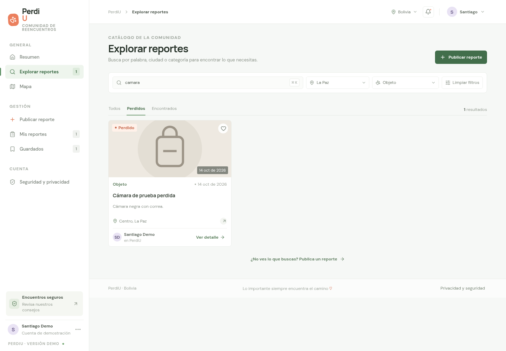
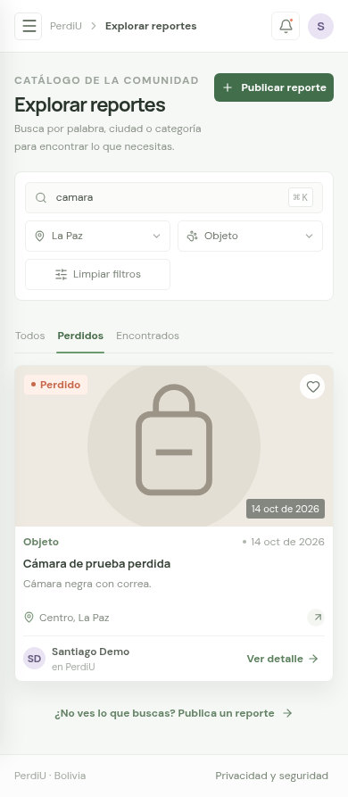

# S1-02: búsqueda y filtros de reportes

Validación del 15 de octubre de 2026 para [S1-02 / issue #2](https://github.com/Alee053/perdi-u/issues/2), sobre S1-01 integrado en `cf8ce8d`. Los datos de aceptación son ficticios y las mutaciones se ejecutaron exclusivamente en PostgreSQL desechable.

## Resultado

Explorar reportes consulta al servidor al cambiar texto, tipo, categoría o ciudad. Busca una frase literal en título o descripción sin distinguir mayúsculas ni tildes. Combina los filtros, excluye resueltos y conserva el orden de creación descendente con ID ascendente en empates, incluidos microsegundos.

Cada consulta devuelve hasta 50 reportes. Al alcanzar ese número, la web muestra «Se muestran hasta 50 resultados» y sugiere ajustar los filtros. No hay total ni paginación. El [contrato HTTP](../../apps/api/README.md#buscar-y-filtrar) documenta parámetros, normalización, límites y errores; no cambian el esquema ni la forma del array público.

## Verificación ejecutada

| Comando                 | Resultado                                                                                                            |
| ----------------------- | -------------------------------------------------------------------------------------------------------------------- |
| `pnpm test`             | 17 pruebas unitarias aprobadas: 8 API/configuración y 9 web.                                                         |
| `pnpm typecheck`        | API, web y contratos sin errores.                                                                                    |
| `pnpm build`            | API, contratos y web compilados mediante Turbo; ejecutado también dentro de aceptación.                              |
| `pnpm test:integration` | 3 pruebas aprobadas contra PostgreSQL 17 aislado.                                                                    |
| `pnpm test:e2e`         | Integración y build aprobados, seguidos del recorrido real API/web/Chromium en escritorio 1440×1000 y móvil 390×844. |

Los fixtures compartidos cubren tildes compuestas/descompuestas, dos ciudades, las tres categorías, pérdida/hallazgo y casos resueltos. Una segunda colección incluye 60 coincidencias con la misma fecha para probar el corte estable en 50 resultados. Las credenciales son efímeras; el runner elimina su contenedor al finalizar.

## Criterios comprobados

| Criterio                                             | Evidencia                                                                                                                                                                                                                                         |
| ---------------------------------------------------- | ------------------------------------------------------------------------------------------------------------------------------------------------------------------------------------------------------------------------------------------------- |
| Texto en título o descripción, sin mayúsculas/tildes | HTTP devuelve los mismos dos registros para `camara`, `CÁMARA`, `cámara` y espacios exteriores. Chromium confirma coincidencias reales enviadas a `/api/reports?q=camara`.                                                                        |
| Combinar texto, tipo, categoría y ciudad             | HTTP y navegador combinan los cuatro filtros; se recorren Perdidos/Encontrados/Todos, Mascota/Objeto/Documentos y ciudades. La búsqueda textual no incluye zona ni autor.                                                                         |
| Activos y orden estable                              | Integración conserva las regresiones de S1-01 y comprueba microsegundos, empate por ID y exclusión del caso resuelto más reciente.                                                                                                                |
| Limpiar filtros                                      | Navegador restablece texto, ciudad, categoría, tipo y catálogo; la prueba del presenter confirma una consulta sin filtros.                                                                                                                        |
| Sin coincidencias y acceso a publicación             | En ambas pantallas se verifica el mensaje exacto y que el botón del estado vacío abre Publicar reporte. También se comprueba un catálogo realmente vacío.                                                                                         |
| Cambios rápidos                                      | El presenter aborta la solicitud anterior y descarta tanto respuestas como errores obsoletos. Chromium cambia rápidamente de texto y termina mostrando la última búsqueda.                                                                        |
| Error y reintento                                    | Un fallo de una búsqueda filtrada muestra error, conserva controles y reintenta la misma consulta sin recargar la página. Se conserva también la prueba de caída/reinicio de la API.                                                              |
| Validación y SQL seguro                              | HTTP comprueba enumeraciones inválidas, parámetros repetidos/estructurados/desconocidos, longitudes, caracteres de control, comillas, `%_` literal y texto de apariencia SQL. Las entradas inválidas reciben `400`, los fallos de consulta `503`. |
| Máximo de 50 resultados                              | PostgreSQL devuelve los 50 IDs esperados de 60 coincidencias. La web muestra 50 tarjetas y el aviso, también al limpiar una búsqueda sin resultados.                                                                                              |
| Privacidad y móvil                                   | Se conserva la proyección pública sin contacto ni claves privadas; el detalle no concede propiedad por nombre. Sin errores de página ni desbordamiento horizontal.                                                                                |
| Regresión de Guardados                               | Se guarda Mochila, se busca `camara`, se abre Guardados y se quita el reporte. Sus datos públicos permanecen en memoria independientemente de la consulta actual.                                                                                 |

## Ciclos de TDD

1. La prueba HTTP de búsqueda falló inicialmente porque devolvía todos los activos; pasó al aplicar normalización y coincidencia literal en SQL.
2. La combinación de filtros falló con `400` antes de incorporar los parámetros; pasó junto con validación, orden y límite.
3. El presenter falló porque enviaba consultas `undefined`; pasó al mapear selecciones, conservar el reintento y permitir limpieza. El cliente falló porque no enviaba parámetros y pasó con su codificación HTTP.
4. Se mantuvieron las regresiones de respuestas obsoletas, incluyendo errores tardíos y cambios de filtros, y se verificó el recorrido completo con servicios reales.
5. La revisión detectó que Guardados dependía del resultado actual de búsqueda. El nuevo recorrido falló al no encontrar la tarjeta guardada; se corrigió conservando su copia pública en memoria, sin añadir persistencia ni nuevas funciones de favoritos.

## Capturas revisadas

Consulta `camara` combinada con Perdidos, Objeto y La Paz, después de reintentar un fallo. Las capturas contienen solo datos ficticios.

## Límites y seguimiento

- La ciudad se compara de forma exacta con su valor almacenado; la eliminación de tildes aplica a la búsqueda textual.
- La búsqueda actual inspecciona texto sin un índice especializado. El límite acota la respuesta; volúmenes mayores requerirán evaluar rendimiento y paginación.
- Publicar, mapa, guardados y autenticación conservan el alcance de demostración documentado en el README.
- La revisión humana y la integración corresponden al equipo en la PR; esta evidencia no las da por aprobadas.
