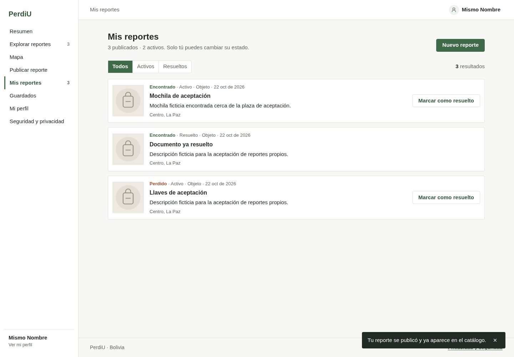
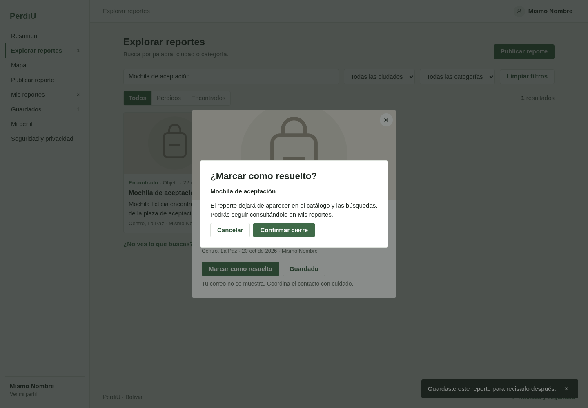
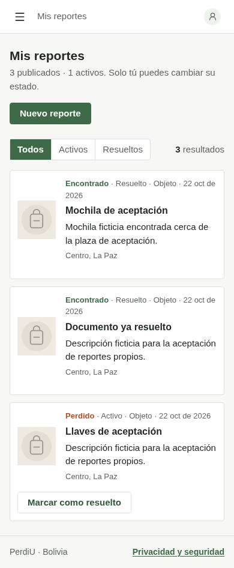
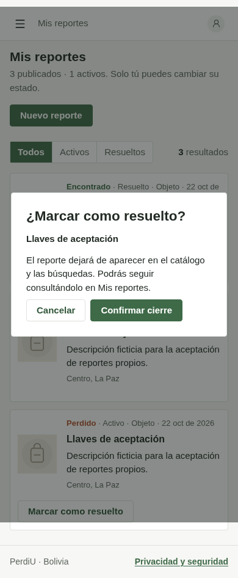

# Validación S1-08: historial propio y cierre persistente

Issue: [#8](https://github.com/Alee053/perdi-u/issues/8). Rama: `feat/s1-08-historial-resolucion`, desde `origin/main` (`9c83fa4`). Node 24.22.0, pnpm 10.29.2, Linux y PostgreSQL 17 desechable.

## Comportamiento y límites

- Historial de la cuenta verificada con título, tipo, estado, vacío y filtros Todos/Activos/Resueltos. Dos propietarios con el mismo nombre siguen separados por identidad.
- Confirmación antes de escribir; cancelar no envía el cierre. Un error conserva el reporte activo y permite reintentar. No se anuncia éxito antes del 204 ni se duplican envíos.
- API con 401 sin sesión válida, 403 para un reporte ajeno, 404 inexistente y 400 para ID/consulta inválidos. No se aceptan identificadores de propietario del cliente.
- PostgreSQL cambia únicamente `state` y conserva tipo, fecha, autor, contacto e imágenes. Repetir con autorización no vuelve a escribir la fila, incluida concurrencia; se compara el registro completo y `xmin`.
- El cierre actualiza historial, detalle, guardados y catálogo conservando la búsqueda. El autor sigue viendo su caso después de recargar y reiniciar la API; terceros no acceden al detalle/contacto resuelto. Se descartan lecturas y contactos de sesiones anteriores.
- Sin migraciones, dependencias, variables nuevas ni cambios de despliegue. Editar/eliminar, reabrir, expiración, mapa real y estadísticas históricas siguen fuera de alcance. El historial privado no hereda el límite público de 50; paginación pendiente de una necesidad posterior.

## Ciclos originales de TDDLab

16 ciclos reales con `pnpm test`, en secuencia. Timestamps en milisegundos originales y hora UTC del 22/10/2026. `testId` agrupa ejecuciones entre commits, no identifica pruebas individuales. Ambos JSON generados se conservan y los hooks originales permanecen intactos.

| Criterio / test                                                 | testId | Rojo: timestamp y fallo                                                   | Verde: timestamp y resultado            | Refactor     |
| --------------------------------------------------------------- | ------ | ------------------------------------------------------------------------- | --------------------------------------- | ------------ |
| Historial de dominio: identidad, ambos estados y proyección     | 41     | `1792643135608` (04:25:35.608): No se consultaba el historial             | `1792643162813` (04:26:02.813), 108/108 | No necesario |
| Filtro por estado e historial mayor a 50                        | 41     | `1792643187642` (04:26:27.642): Se incluía el activo al pedir resueltos   | `1792643209178` (04:26:49.178), 109/109 | No necesario |
| Cierre: identidad y resultados del puerto atómico               | 41     | `1792643234361` (04:27:14.361): No se transmitía el cierre al puerto      | `1792643258493` (04:27:38.493), 110/110 | No necesario |
| Consulta HTTP privada: estado permitido y propietario prohibido | 42     | `1792643308818` (04:28:28.818): Se ignoraba el estado válido              | `1792643329163` (04:28:49.163), 111/111 | No necesario |
| Model web: identidad y filtros                                  | 43     | `1792643521494` (04:32:01.494): La selección devolvía un vacío            | `1792643540059` (04:32:20.059), 112/112 | No necesario |
| Cliente privado: DTO, bearer y PATCH                            | 43     | `1792643563538` (04:32:43.538): No devolvía los reportes                  | `1792643586426` (04:33:06.426), 113/113 | No necesario |
| Cliente: sesión y fallos de permisos                            | 43     | `1792643604998` (04:33:24.998): No distinguía sesión ausente              | `1792643625335` (04:33:45.335), 114/114 | No necesario |
| Presenter: lista, carga y filtros                               | 43     | `1792643658235` (04:34:18.235): Permanecía idle sin cargar                | `1792643680225` (04:34:40.225), 115/115 | No necesario |
| Presenter: confirmar, cancelar y reintentar                     | 43     | `1792643702654` (04:35:02.654): No abría la confirmación                  | `1792643721168` (04:35:21.168), 116/116 | No necesario |
| Presenter: cierre tardío de otra cuenta                         | 43     | `1792643741069` (04:35:41.069): Anunciaba éxito de la cuenta anterior     | `1792643761285` (04:36:01.285), 117/117 | No necesario |
| Sesión rechazada desde una ruta privada                         | 43     | `1792643807817` (04:36:47.817): La vista conservaba authenticated         | `1792643823669` (04:37:03.669), 120/120 | No necesario |
| Detalle: cierre confirmado y lectura anterior                   | 43     | `1792643859295` (04:37:39.295): No ofrecía el cierre al autor             | `1792643882469` (04:38:02.469), 121/121 | No necesario |
| Catálogo: cierre sin perder búsqueda                            | 43     | `1792643903801` (04:38:23.801): La consulta anterior reintroducía el caso | `1792643922010` (04:38:42.010), 122/122 | No necesario |
| Guardados: cierre confirmado                                    | 43     | `1792643951059` (04:39:11.059): El caso seguía en guardados               | `1792643969950` (04:39:29.950), 123/123 | No necesario |
| Demo: retirar cierre simulado                                   | 43     | `1792643995081` (04:39:55.081): La demo todavía ofrecía resolver          | `1792644011070` (04:40:11.070), 122/122 | No necesario |
| Contacto tardío de otra sesión tras el cierre                   | 44     | `1792644336931` (04:45:36.931): Restauraba el detalle activo              | `1792644360726` (04:46:00.726), 123/123 | No necesario |

El comparador de orden se comparte con el catálogo público sin cambiar su comportamiento. Las comprobaciones de carga/error/vacío y descarte de listas/sesiones ya soportadas al añadirse son regresiones inicialmente verdes, no ciclos nuevos. Se retiró una prueba del flujo de resolver/eliminar demo al eliminar ese flujo del presenter; permanecen las pruebas de sus helpers y del resto de la demo. El formatter se ejecutó antes de la última comprobación verde.

Las integraciones siguieron sus propios rojos/verdes: `GET /me/reports` y `PATCH /reports/:id/resolve` fallaron inicialmente con 404 en lugar de 401 porque no existían. Después pasaron sus escenarios con PostgreSQL aislado. El fallo real de BD fue una comprobación adicional inicialmente verde. Esas ejecuciones no se atribuyen al recorder unitario. El fallo de compilación del scaffold inicial y el selector exacto de «Categoría» en la primera aceptación no se cuentan como rojos de producto.

## Verificación reproducible

- `pnpm test`: 123/123 unitarias al completar el último ciclo, incluidos los tests de herramientas.
- `pnpm test:integration --test-name-pattern='mis reportes HTTP|resolver HTTP|un fallo real de PostgreSQL'`: 3/3 escenarios propios con SQL real.
- `pnpm test:e2e`: integración de migraciones, 15/15 escenarios HTTP y navegador público móvil/escritorio.
- `pnpm test:auth --with-browser`: GoTrue, Mailpit, API, PostgreSQL y Chromium reales; dos cuentas confirmadas y nombre público igual. Publicación por formulario → búsqueda → detalle/contacto con otra cuenta → cierre → recarga desde perfil → reinicio. También prueba filtros, vacío, cancelación, error/reintento, cambio de cuenta, foco/teclado y ausencia de eliminación. WhatsApp se intercepta sin enviar mensajes. Solo los 503 deliberados del navegador son dobles; el fallo real de PostgreSQL se comprueba en HTTP.
- `pnpm verify`: aprobado sobre el árbol final; incluye formato, enlaces/skills, límites MVP/workspaces, tipos, unitarias y build.
- `pnpm check:docs --since origin/main` y `git diff --check`: estructura e impacto revisados junto al contenido.

Una ejecución de aceptación autenticada simultánea con el E2E público agotó la espera de «Mis reportes» después del login. Se añadió diagnóstico de estados HTTP (rutas sin query ni credenciales) y captura de fallo; la repetición secuencial pasó completamente, incluidas las nuevas aserciones de foco y Escape. La causa del timeout puntual no se estableció y no se presenta como un ciclo rojo de producto. Los escenarios finales de E2E público y aceptación autenticada quedaron aprobados.

## Capturas con datos ficticios

Se inspeccionaron móvil y escritorio: sin desbordes horizontales, tipo y estado separados, confirmación visible, foco inicial en Cancelar y teclado Escape. Capturas generadas por el recorrido autenticado:

## Documentación y revisión

Revisados README, guías API/database, arquitectura general/MVP, Auth, pruebas y mapa de mantenimiento. Se actualizó la regla y los ejemplos de la skill MVP para que historial/cierre usen identidad verificada y persistencia; las demás skills siguen remitiendo a sus fuentes canónicas y no requieren cambios. El chequeo de enlaces verifica estructura, no vigencia semántica; esta se contrastó con código y recorridos.

La revisión humana y la integración en main quedan a cargo del equipo. La PR no despliega ni modifica datos compartidos.
