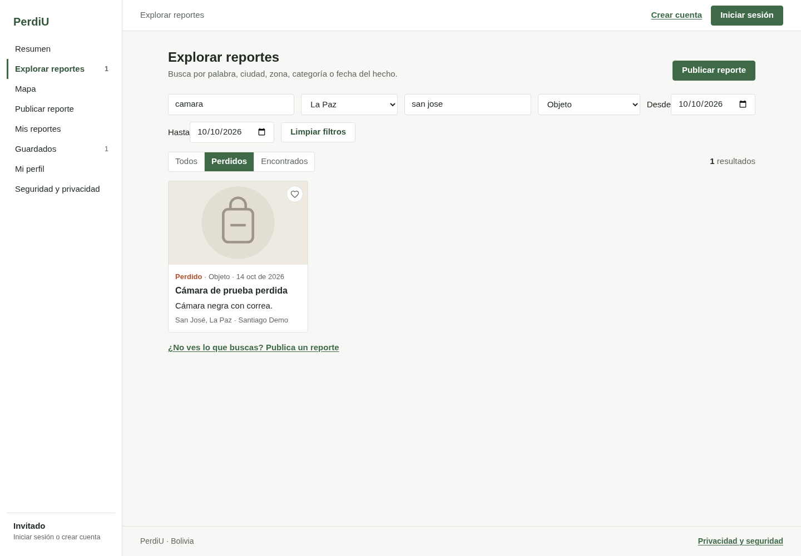
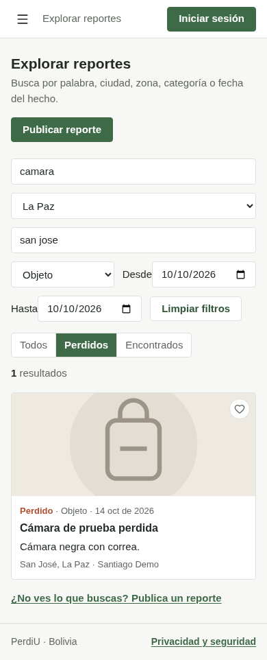

# Validación de S2-02: rango de fechas del hecho

La [issue #25](https://github.com/Alee053/perdi-u/issues/25) permite acotar el catálogo por la fecha del hecho. La integración conserva el trabajo de la [PR Draft #40](https://github.com/Alee053/perdi-u/pull/40) y lo combina con zona de S2-01, ya integrada en `main`.

## Comportamiento comprobado

- `dateFrom` y `dateTo` son opcionales, inclusivos y admiten rangos abiertos o de un solo día. La API valida calendario, formato estricto y orden; rechaza parámetros repetidos o estructurados con un mensaje seguro.
- PostgreSQL filtra `incident_date` con parámetros antes de ordenar por creación e ID y limitar a 50. Una búsqueda recupera los diez registros del día 11 que quedan después de los primeros 50 registros del día 10. La cámara del día 10, publicada el 14, no aparece al buscar el día 14.
- Texto, tipo, categoría, ciudad, zona y fechas se combinan con AND. Se mantienen activos, DTO público y normalización de zona; no se añaden migraciones, índices ni dependencias.
- Model valida el rango; Presenter conserva entradas y mensajes, cancela consultas anteriores y bloquea el rango inválido incluso al refrescar sin una selección nueva. View representa controles y errores accesibles. La invalidez nativa se conserva aunque Chromium entregue un valor vacío; cambio, teclado y salida del campo comunican su estado, sin consultas duplicadas. Limpiar también vacía los segmentos del editor nativo.
- Cliente y presenter comprueban serialización, carga/error/reintento, limpieza y descarte de respuestas o errores anteriores al cambiar fechas.

## TDDLab

Se reconciliaron las dos secuencias originales sin descartar ejecuciones, cambiar resultados ni renumerar `testId`. Los marcadores `HEAD` de los últimos commits registrados se resolvieron a sus SHA originales. Los IDs 58–60 aparecen en ambas ramas porque sus ciclos se registraron en paralelo; sus timestamps y referencias conservan la procedencia.

Las regresiones se registraron con `pnpm test` sobre Node 24.22.0 y pnpm 10.29.2:

| Criterio / test                                                                                                                   | `testId` | Rojo: `timestamp` y fallo                                                                         | Verde: `timestamp` y resultado                         | Refactor                                                                                   |
| --------------------------------------------------------------------------------------------------------------------------------- | -------- | ------------------------------------------------------------------------------------------------- | ------------------------------------------------------ | ------------------------------------------------------------------------------------------ |
| `reintentar o refrescar no recupera una búsqueda anterior mientras el rango sea inválido`, en `apps/web/test/catalog.test.ts`     | 62       | `1794794854301`: el refresco repetía la consulta anterior; 1 fallida, 162 aprobadas.              | `1794795230813`: 163 aprobadas, 0 fallidas, 35 suites. | No necesario. El presenter conserva la validez del rango entre llamadas.                   |
| `una fecha inválida del control nativo muestra error sin buscar y permite corregir o limpiar`, en `apps/web/test/catalog.test.ts` | 62       | `1794795854934`: el valor vacío con invalidez nativa perdía el mensaje; 1 fallida, 163 aprobadas. | `1794796266227`: 164 aprobadas, 0 fallidas, 35 suites. | No necesario. La validez del control es un dato de entrada, separado de una fecha ausente. |
| Mismo test: eventos de teclado/salida con el mismo valor y validez                                                                | 62       | `1794796834466`: el evento repetido emitía una tercera consulta; 1 fallida, 163 aprobadas.        | `1794796876363`: 164 aprobadas, 0 fallidas, 35 suites. | No necesario. Se ignoran eventos que no cambian el filtro.                                 |

La caracterización ampliada de combinación, serialización y respuestas obsoletas pasó con `pnpm test` en `1794795431274`: 163 pruebas aprobadas. Las ejecuciones previas del mismo criterio también permanecen en el registro; no se reconstruyó evidencia retroactiva del trabajo heredado.

## Comandos y revisión

`pnpm verify` pasó: formato, documentos/skills, límites entre workspaces y capas MVP, tipos, 164 unitarias en 35 suites y build. `pnpm check:docs --since origin/main` identificó las fuentes afectadas; se actualizaron README, guía de API con ejemplos abiertos/cerrados/de un día, guía MVP, pruebas y ejemplos de la skill MVP. Las responsabilidades, instrucciones y accesos de las demás skills siguen vigentes.

`pnpm test:integration --test-name-pattern='la búsqueda HTTP'` pasó en un PostgreSQL 17 desechable: un escenario HTTP aprobado con 16 escenarios no seleccionados. Incluye fechas inexistentes, repeticiones/estructuras de ambos parámetros, combinación de todos los filtros y aplicación antes del límite.

`pnpm test:e2e` pasó: una prueba de migraciones, 17 pruebas HTTP y recorrido Chromium con datos ficticios. En escritorio (`America/La_Paz`) y móvil (`Pacific/Kiritimati`) se comprobaron límites abiertos/cerrados y de un día, combinación con zona y demás filtros, rango invertido, fechas nativas imposibles o parciales, corrección/limpieza, error/reintento y ausencia de desbordamiento. La edición parcial desde un campo vacío falló primero porque no aparecía la alerta; pasó al comunicar también teclado y salida del campo, ya que Chromium puede omitir `input` y `change` mientras no existe un valor serializable.

La revisión local de estándares y criterios corrigió los hallazgos de validación antes de publicar. La revisión humana y el merge corresponden al equipo.

## Integración con el detalle ampliado de S2-03

Se incorporó `origin/main` en `7e9e615` a la rama de S2-02. El código se combinó automáticamente; el conflicto de `docs/testing.md` conserva las secciones de fechas y galería. Los dos JSON de TDDLab conservan los 103 registros de commits y 360 eventos históricos combinados, incluidos los duplicados anteriores, con sus resultados, timestamps y `testId` originales. Se resolvieron los marcadores `HEAD` a `06b3f30` y `863b137`; la referencia compartida de S2-01 conserva el SHA comprobado `fe82067`.

La ejecución de `pnpm test` en `1794921491100`, `testId` 64, es caracterización de la integración: 167 pruebas aprobadas en 35 suites. Los ciclos rojo/verde de ambas historias permanecen en el registro. La instrumentación original y los hooks se conservaron íntegros.

Con Node 24.22.0 y pnpm 10.29.2 pasaron `pnpm verify` y `pnpm test:e2e`: formato, documentación, capas MVP, tipos, unitarias, build, una prueba de migraciones, 17 pruebas HTTP sobre PostgreSQL desechable y los recorridos de Chromium en móvil/escritorio, incluidos filtros de fechas, detalle y galería. Se revisaron las fuentes afectadas por `pnpm check:docs --since origin/main`; las instrucciones de las skills siguen vigentes.

## Capturas

Consulta `camara`, Perdidos, Objeto, La Paz, zona `san jose` y un rango del día 10, después de reintentar un fallo. La cámara ocurrió el día 10 aunque su tarjeta muestra publicación del día 14. Se revisaron las dos capturas con datos ficticios y sin avisos que oculten los resultados.

